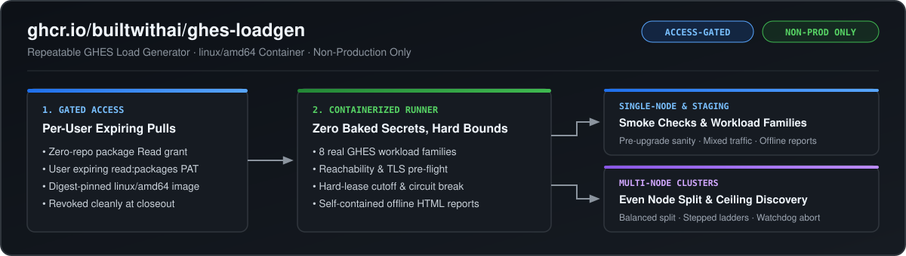
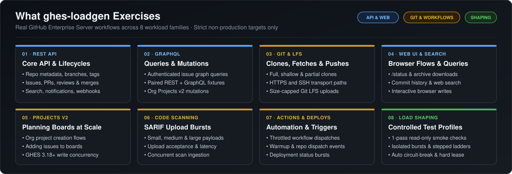
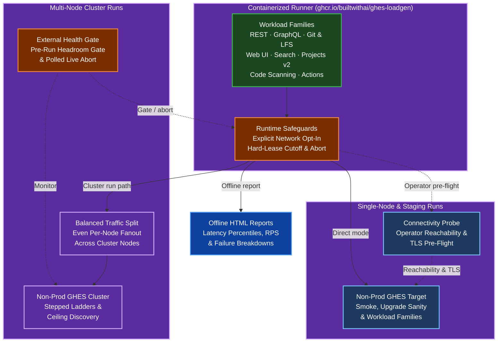

# ghes-loadgen

> ** For Non-production targets only. **
>
> `ghcr.io/builtwithai/ghes-loadgen` is a private `linux/amd64` container image. An anonymous `docker pull` returns `403 Forbidden` on purpose. Never point this at production. Maintained independently by [`@megamanics`](https://github.com/megamanics) — no GitHub Support, no SLA. See [`SUPPORT.md`](SUPPORT.md).



---

## Five `curl /status` Calls Is Not a Load Test

Everybody's GitHub Enterprise Server staging appliance looks rock-solid right after five `curl /status` checks come back `200 OK`.

That is like testing a restaurant kitchen for Friday dinner service by boiling one pot of water on burner one. Nobody is cloning a multi-gigabyte monorepo. Nobody is uploading SARIF code scans. Nobody is hammering GraphQL and Projects v2 while CI workflow dispatches hit the queue at the same time. Everything stays serene right up until the doors open on Monday morning.

`ghes-loadgen` exists for one job: **putting repeatable, bounded, multi-surface pressure on non-production GitHub Enterprise Server appliances before real users find the ceiling for you.**

It runs real GHES workflows — read-only smoke checks, mixed workday traffic, isolated single-family bursts, and stepped capacity ladders — with hard time limits and self-contained offline HTML reports.

---

## What It Exercises



| Workload Family | What It Puts Under Pressure | Typical Use |
|---|---|---|
| **REST API** | Repo metadata, branches, commits, issues, PRs, reviews, PR merges, search, notifications, internal webhooks | Pre-upgrade sanity checks and core API latency baselines |
| **GraphQL** | Authenticated issue graph queries paired with REST fixtures, plus Projects v2 mutations | Catching GraphQL latency regressions alongside API traffic |
| **Git & Git LFS** | Full, shallow, and partial clones; fetches, pulls, isolated branch pushes, monorepos, and per-object size-capped LFS uploads over HTTPS and SSH | Measuring CI clone storms and storage throughput without colliding branches |
| **Web UI & Search** | `/status` baseline, raw file and archive downloads, commit history browsing, search queries, interactive web writes | Validating end-to-end browser flows alongside API traffic |
| **Projects v2** | Organization project creation and adding issues to boards under concurrency (GHES `>= 3.18`) | Stress-testing planning-board writes before wider rollout |
| **Code Scanning (SARIF)** | Bundled small, medium, and large SARIF upload acceptance (`202`) and latency bursts | Measuring SARIF ingestion headroom before enabling scanning org-wide |
| **Actions & Deployments** | Throttled workflow dispatches, warmup bursts, repository dispatch events, and deployment status bursts | Testing automation spikes and event fanout |
| **Load Shaping** | 1-pass read-only smoke, isolated non-overlapping bursts, stepped capacity ladders with auto circuit-break, and bounded concurrency ramps | Isolating one noisy workload family at a time instead of staring at a blended soup of metrics |

Full workload family breakdown and execution patterns: [`docs/vectors.md`](docs/vectors.md).

---

## Built-In Guardrails (Because Nobody Wants to Melt the Wrong Box)

A load generator without brakes is just a self-inflicted outage with nicer charts. Four rules hold on every run:

1. **Fails closed on networking.** Direct modes (`direct-probe` and `direct`) refuse to start with exit code `64` unless you explicitly pass `GHES_LOADGEN_ALLOW_NETWORK=1`.
2. **Zero baked credentials.** Test accounts, repository lists, and optional ephemeral SSH keys are mounted read-only at runtime. Nothing sensitive ships inside the image.
3. **Polled hard-lease cutoff.** Every workload run enforces an outer duration ceiling (`GHES_HARD_LEASE_SECS`) followed by graceful termination, so a dropped SSH session never leaves traffic running overnight.
4. **Cluster headroom gating.** Multi-node cluster runs distribute traffic evenly across nodes and pair a pre-run headroom gate with a polled watchdog that aborts the container if target headroom drops below threshold.

Before starting load on a single-node target, run `direct-probe` as a manual pre-flight reachability and TLS check (`direct` does not invoke it automatically). On self-signed non-production appliances, pass `GHES_INSECURE_TLS=1` to **both** `direct-probe` and `direct` so Git-over-HTTPS traffic doesn't fail certificate verification after the probe passes.



*Standalone diagram: [`docs/diagrams/architecture-and-vectors.md`](docs/diagrams/architecture-and-vectors.md).*

---

## Why `docker pull` Returns `403` (and How Access Works)

Anonymous pulls fail on purpose. There is no shared password taped to a wiki page, no permanent org membership, and every operator gets an explicit release digest (`@sha256:...`) and pulls by that digest regardless of any moving tags.

Access is granted to your named GitHub account for a bounded test window (package `Read` only via a secret zero-repository-access team with org base permissions locked to `No permission` — or an air-gapped `.tar.gz` archive with an out-of-band SHA256 checksum if your network blocks `ghcr.io` or org membership isn't permitted), authenticated with your **own expiring classic `read:packages` PAT**, and closed out cleanly on both sides when testing ends.

```mermaid
flowchart LR
  classDef user fill:#0d419d,stroke:#58a6ff,stroke-width:2px,color:#ffffff
  classDef owner fill:#6e40c9,stroke:#bc8cff,stroke-width:2px,color:#ffffff
  classDef registry fill:#1b4721,stroke:#3fb950,stroke-width:2px,color:#ffffff
  classDef runner fill:#5a3e00,stroke:#d29922,stroke-width:2px,color:#ffffff
  classDef revoke fill:#6e1a1a,stroke:#f85149,stroke-width:2px,color:#ffffff

  subgraph S1["1. Scope"]
    A["Request access<br/>privately"]:::user
    B["Confirm non-prod target<br/>& test window"]:::owner
    A --> B
  end

  subgraph S2["2. Grant & PAT"]
    C["Grant named account<br/>package Read only"]:::owner
    D["Create expiring<br/>read:packages PAT"]:::user
    E["Authorize SAML SSO<br/>if linked to org"]:::user
    B --> C --> D --> E
  end

  subgraph S3["3. Pull & Run"]
    F["docker login ghcr.io<br/>--password-stdin"]:::registry
    G["Pull digest-pinned<br/>linux/amd64 image"]:::registry
    H["Check reachability & TLS<br/>with direct-probe"]:::runner
    I["Run bounded load &<br/>collect HTML report"]:::runner
    E --> F --> G --> H --> I
  end

  subgraph S4["4. Closeout"]
    J["Delete PAT & run<br/>docker logout ghcr.io"]:::revoke
    K["Remove local image<br/>& workspace files"]:::revoke
    L["Revoke window-scoped<br/>package Read grant"]:::revoke
    I --> J --> K --> L
  end
```



*Standalone diagram: [`docs/diagrams/access-lifecycle.md`](docs/diagrams/access-lifecycle.md) · Full operator & maintainer runbook (including offline `.tar.gz` transfer): [`docs/access-lifecycle.md`](docs/access-lifecycle.md).*

### 1. Request Access Privately

Reach [`@megamanics`](https://github.com/megamanics) through your existing channel (see [`SUPPORT.md`](SUPPORT.md)) with your non-production GHES version, single-node vs. cluster setup, and testing window. **Never post hostnames, private IPs, topologies, or credentials in public issues.**

Once approved, you receive an immutable digest reference (`ghcr.io/builtwithai/ghes-loadgen@sha256:<DIGEST>`), the matching OCI revision SHA, and the runnable workload configuration bundle for your target.

### 2. Create Your Own Expiring `read:packages` PAT and Pull

On `github.com`, go to **Settings** → **Developer settings** → **Personal access tokens** → **Tokens (classic)** → **Generate new token (classic)**. *(GHCR container pulls require a classic PAT; air-gapped `.tar.gz` operators skip this step.)*

- Set **Expiration** to your test window close date (never "No expiration").
- Select **only** `read:packages`.
- If your account is linked to SAML SSO for the package-owning organization (`builtwithai`), click **Configure SSO** on the token and authorize it for `builtwithai`.

Then log in and pull from a **dedicated Linux `x86_64` load generator host** (don't fire load tests from your laptop):

```bash
export GH_USER="<your-github-username>"
export LOADGEN_IMAGE="ghcr.io/builtwithai/ghes-loadgen@sha256:<DIGEST_FROM_MAINTAINER>"

read -rsp "Enter expiring read:packages PAT: " GHCR_PAT
echo
printf '%s\n' "${GHCR_PAT}" | docker login ghcr.io -u "${GH_USER}" --password-stdin && \
  docker pull --platform linux/amd64 "${LOADGEN_IMAGE}" && \
  docker image inspect \
    --format 'arch={{.Architecture}} id={{.Id}} size={{.Size}} rev={{index .Config.Labels "org.opencontainers.image.revision"}}' \
    "${LOADGEN_IMAGE}"
unset GHCR_PAT
```

### 3. Check Reachability and TLS Before Generating Load

Yes, `direct-probe` literally makes five `/status` calls by default — its only job is confirming network reachability and TLS before any real load starts, not grading appliance health. It fails closed (exit `64`) without `GHES_LOADGEN_ALLOW_NETWORK=1` and verifies TLS by default:

```bash
export GHES_HOST="ghes-nonprod.example.internal"

# TLS verification is enabled by default; pass -e GHES_INSECURE_TLS=1 ONLY for self-signed
# non-prod certs (and pass the same flag to `direct` runs so Git-over-HTTPS doesn't fail TLS).
docker run --rm --platform linux/amd64 --name ghes-loadgen-probe \
  -e GHES_LOADGEN_ALLOW_NETWORK=1 \
  -e "GHES_HOST=${GHES_HOST}" \
  "${LOADGEN_IMAGE}" direct-probe
```

Check the `DIRECT_PROBE_HTTPS ok=N total=N tls_verify=...` line printed right before `DIRECT_PROBE_OK` to confirm **`ok` equals `total`** (non-2xx responses still count as reachable contacts), and verify `https://${GHES_HOST}/status` returns a healthy `200 OK` separately before starting load.

### 4. Run Workloads and Build Missing Reports Offline

Runnable workload configuration files, fixture templates, and target-specific run commands (for single-node `direct` runs or multi-node cluster runs) are delivered privately once access is granted.

After a run finishes, the container generates a self-contained HTML report on a best-effort basis (throughput, latency percentiles, and failure breakdown). To build a missing HTML report completely offline from an existing run directory (requires readable raw run data and a writable results directory for the supplied UID/GID; skips runs that already have a completed report):

```bash
export RUN_DIR="$(pwd)/work/run-<timestamp>"

docker run --rm --network=none --pull=never --platform linux/amd64 \
  --user "$(id -u):$(id -g)" \
  -v "${RUN_DIR}:/workspace/run" \
  "${LOADGEN_IMAGE}" report
```

### 5. Close Out Cleanly

When the testing window closes, clean up locally first — delete your PAT, wipe stored registry credentials, remove the local image/workspace files, and clear test objects or org settings on the non-prod target — then notify [`@megamanics`](https://github.com/megamanics) to revoke your window-scoped registry grant:

```bash
# 1. Delete your read:packages classic PAT on github.com (GHCR pull path)
# 2. Log out of GHCR and check active Docker config (also clear any OS credential helper)
docker logout ghcr.io || echo "WARNING: docker logout failed" >&2
DOCKER_CFG="${DOCKER_CONFIG:-$HOME/.docker}/config.json"
if [[ -f "${DOCKER_CFG}" ]] && grep -q 'ghcr.io' "${DOCKER_CFG}"; then
  echo "WARNING: ghcr.io entry still present in ${DOCKER_CFG}" >&2
else
  echo "CHECKED_DOCKER_CONFIG"
fi

# 3. Stop any leftover container, remove the image, and delete local workspace files
export LOADGEN_IMAGE="ghcr.io/builtwithai/ghes-loadgen@sha256:<DIGEST_FROM_MAINTAINER>"
docker rm -f ghes-loadgen ghes-loadgen-probe 2>/dev/null || true
docker rmi "${LOADGEN_IMAGE}"
rm -rf ./work
```

Notify [`@megamanics`](https://github.com/megamanics) in your private thread so window-scoped package `Read` access is revoked on the registry side.

---

## Install as an Agent Skill / Plugin

This repository ships a reusable [`ghes-loadgen-smoke`](skills/ghes-loadgen-smoke/SKILL.md) Agent Skill (with preflight checks, troubleshooting pitfalls, and clean closeout verification) packaged as a plugin for Copilot CLI and Claude Code, with manual install support for other Agent Skills clients:

**GitHub Copilot CLI:**

```bash
copilot plugin install builtwithai/ghes-loadgen
```

**Claude Code:**

```text
/plugin marketplace add builtwithai/ghes-loadgen
/plugin install ghes-loadgen@ghes-loadgen
```

**Local / manual skill install:** Copy `skills/ghes-loadgen-smoke/` into your client's skills directory (for example `~/.copilot/skills/ghes-loadgen-smoke/` or `~/.claude/skills/ghes-loadgen-smoke/`).

---

## Repository Contents

| Path | What's Inside |
|---|---|
| [`README.md`](README.md) | What `ghes-loadgen` does, built-in safeguards, gated pull flow, and closeout |
| [`skills/ghes-loadgen-smoke/SKILL.md`](skills/ghes-loadgen-smoke/SKILL.md) | Reusable Agent Skill for from-scratch 44-vector non-prod smoke setup, execution, and closeout ([preflight & pitfalls reference](skills/ghes-loadgen-smoke/references/preflight-and-pitfalls.md)) |
| [`.claude-plugin/plugin.json`](.claude-plugin/plugin.json) | Plugin & marketplace manifests ([`marketplace.json`](.claude-plugin/marketplace.json)) for installing the skill in Copilot CLI and Claude Code |
| [`docs/vectors.md`](docs/vectors.md) | Detailed breakdown of the 8 workload families and shaping modes |
| [`docs/access-lifecycle.md`](docs/access-lifecycle.md) | Complete operator & maintainer runbook for gated pulls, offline `.tar.gz` delivery, and revocation |
| [`docs/diagrams/access-lifecycle.md`](docs/diagrams/access-lifecycle.md) | Standalone Mermaid diagram of the gated access & closeout lifecycle (`.mmd` included) |
| [`docs/diagrams/architecture-and-vectors.md`](docs/diagrams/architecture-and-vectors.md) | Standalone Mermaid diagram of runner safeguards, execution paths, and offline reporting (`.mmd` included) |
| [`docs/private-intake-form.yml`](docs/private-intake-form.yml) | Ready-to-use GitHub Issue Form YAML for a private intake repository |
| [`SUPPORT.md`](SUPPORT.md) | Non-production ground rules, no-SLA notice, and maintainer contact (`@megamanics`) |
| [`.github/ISSUE_TEMPLATE/config.yml`](.github/ISSUE_TEMPLATE/config.yml) | Disables blank public issues and routes access requests to `SUPPORT.md` |

---

*Find the real ceiling on Tuesday in staging, so Monday morning in production stays boring.*
