# Gated Access, PAT Authentication, and Revocation Lifecycle

This diagram shows the full lifecycle for `ghcr.io/builtwithai/ghes-loadgen`: private scoping, gated GHCR package `Read` access (via a zero-repository-access team in `builtwithai`, or an offline `.tar.gz` fallback), operator-owned expiring classic `read:packages` PAT login, digest-pinned execution against non-production GHES, and dual closeout teardown.

```mermaid
flowchart LR
  classDef user fill:#0d419d,stroke:#58a6ff,stroke-width:2px,color:#ffffff
  classDef owner fill:#6e40c9,stroke:#bc8cff,stroke-width:2px,color:#ffffff
  classDef registry fill:#1b4721,stroke:#3fb950,stroke-width:2px,color:#ffffff
  classDef runner fill:#5a3e00,stroke:#d29922,stroke-width:2px,color:#ffffff
  classDef revoke fill:#6e1a1a,stroke:#f85149,stroke-width:2px,color:#ffffff

  subgraph S1["1. Scope"]
    A["Request access<br/>privately"]:::user
    B["Confirm non-prod target<br/>& test window"]:::owner
    A --> B
  end

  subgraph S2["2. Grant & PAT"]
    C["Grant named account<br/>package Read only"]:::owner
    D["Create expiring<br/>read:packages PAT"]:::user
    E["Authorize SAML SSO<br/>if linked to org"]:::user
    B --> C --> D --> E
  end

  subgraph S3["3. Pull & Run"]
    F["docker login ghcr.io<br/>--password-stdin"]:::registry
    G["Pull digest-pinned<br/>linux/amd64 image"]:::registry
    H["Check reachability & TLS<br/>with direct-probe"]:::runner
    I["Run bounded load &<br/>collect HTML report"]:::runner
    E --> F --> G --> H --> I
  end

  subgraph S4["4. Closeout"]
    J["Delete PAT & run<br/>docker logout ghcr.io"]:::revoke
    K["Remove local image<br/>& workspace files"]:::revoke
    L["Revoke window-scoped<br/>package Read grant"]:::revoke
    I --> J --> K --> L
  end
```

## Key Security Controls

| Stage | Control | Why it matters |
|---|---|---|
| **Scoping** | Private intake routing (plus disabling public Issues if desired) | Keeps hostnames, private IPs, and topologies off public issues. |
| **Access Grant** | Zero-repo org baseline + secret team with package `Read` (or offline `.tar.gz` when org membership or cross-org visibility isn't permitted) | Grants pull access to the private container without exposing repositories or sharing static tokens. |
| **Client Auth** | Operator-owned expiring classic `read:packages` PAT | Least-privilege pull scope with a built-in expiration date. |
| **Image Pinning** | Digest-pinned `linux/amd64` pull (`@sha256:...`) | Reproducible runs against an exact verified image digest. |
| **Closeout** | Dual teardown (operator deletes PAT, logs out, clears local artifacts & target test objects; maintainer revokes window-scoped grants) | Clears local credentials/files and stops future authorized pulls. |
