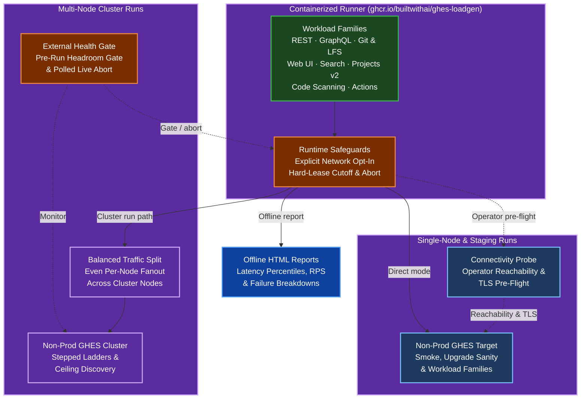

# Runner Architecture and Workload Paths

This diagram shows how `ghcr.io/builtwithai/ghes-loadgen` separates workload generation, built-in runtime safeguards, single-node and multi-node execution paths, and offline HTML reporting.

## Built-In Safeguards

- **Explicit network opt-in:** Direct container modes (`direct-probe` and `direct`) refuse to run unless `GHES_LOADGEN_ALLOW_NETWORK=1` is set (exiting with status `64` otherwise). `direct-probe` is an operator-run HTTPS reachability and TLS pre-flight (`GHES_INSECURE_TLS=1` disables certificate verification for self-signed non-production appliances on both `direct-probe` and `direct` runs).
- **Zero baked credentials:** Test tokens, fixture inputs, and optional non-production SSH keys are mounted read-only at runtime — nothing sensitive lives inside the container image.
- **Hard-lease duration ceiling:** Every run enforces a polled outer workload cutoff (`GHES_HARD_LEASE_SECS`) so a disconnected terminal never leaves a forgotten load run hammering an appliance overnight.
- **Offline HTML reports:** Summary reports (throughput, latency percentiles, and failure breakdowns) are generated locally on a best-effort basis after a run, and missing reports can be built offline under `--network=none` via the `report` mode.
- **External health gates for clusters:** Multi-node runs pair even per-node traffic distribution with a pre-run headroom gate and a polled watchdog that aborts the container if target headroom drops below threshold.
