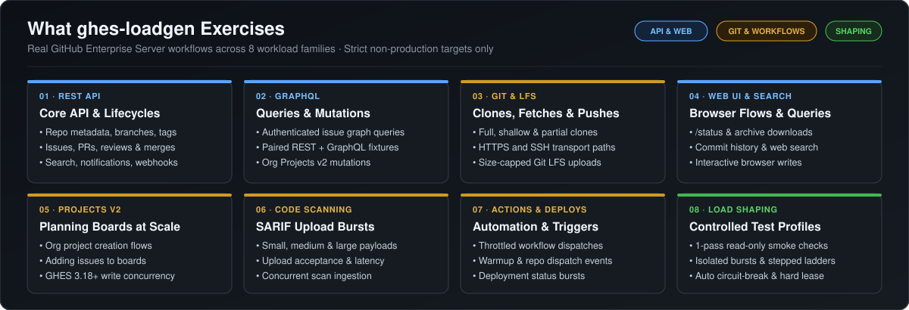

# Workload Families and Test Modes

`ghcr.io/builtwithai/ghes-loadgen` generates realistic, repeatable load across eight GitHub Enterprise Server (GHES) workload families. Every workload targets **non-production appliances only**.

Runnable workload configuration files, fixture templates, and target-specific invocation commands are shared privately once pull access is granted. This page describes what the container exercises, which surfaces are read-only versus read/write, and what shaping controls exist.

---

## 1. Workload Families

### REST API

Exercises core `/api/v3` paths across both lightweight read baselines and sustained write lifecycles:

| Capability | Access | What It Exercises |
|---|:---:|---|
| Repository metadata | Read | Language lists, tags, branches, and branch comparisons |
| Commit & org lookups | Read | Commit history/details, organization memberships, repository collaborators |
| Search & notifications | Read | Issue search queries and user notification feeds |
| Repository & branch writes | Read/Write | Branch operations, content reads/updates, low-level Git object/ref calls, repo creation |
| Issues & pull requests | Read/Write | Issue and PR creation, comments, reviews, commit statuses, and standard PR merges |
| Webhooks & dispatches | Write | Repository dispatch events and webhook deliveries — configure an approved internal non-production receiver URL in your private profile, or keep the webhook workload disabled |

### GraphQL

Exercises authenticated `/api/graphql` queries and mutations paired with non-production fixtures:

| Capability | Access | What It Exercises |
|---|:---:|---|
| Issue graph queries | Read/Write | Authenticated GraphQL issue lookups paired with REST issue-creation fixtures |
| Projects v2 GraphQL mutations | Write | Organization-level Projects v2 board creation and issue additions on GHES `>= 3.18` |

### Git and Git LFS (HTTPS & SSH)

Exercises real Git transport operations over both HTTPS and SSH, cleaning local temporary clone directories automatically before and after runs without modifying target repositories on read-only profiles:

| Capability | Access | What It Exercises |
|---|:---:|---|
| Shallow clones | Read | CI-style `--depth` clones over HTTPS or SSH |
| Full & partial clones | Read | Complete repository clones and blobless/treeless partial clones |
| Fetch & pull cycles | Read | Repeated incremental `git fetch` and `git pull` traffic |
| Commit & push flows | Write | Synthetic commit creation and branch pushes, with per-user branch isolation to prevent push collisions |
| Monorepo profiles | Read/Write | High-volume clone/fetch/push traffic targeted at dedicated large test repositories |
| Git LFS uploads | Write | Binary object uploads alongside Git push/clone workflows, with a per-object size cap (note: the cap bounds individual object size, not cumulative repository storage across long runs) |

### Web UI and Search

Exercises browser-like authenticated web traffic alongside read-only health and archive paths:

| Capability | Access | What It Exercises |
|---|:---:|---|
| Health baseline | Read | Lightweight `/status` polling without authentication overhead |
| Raw file & archive downloads | Read | Authenticated raw file fetches and repository ZIP downloads |
| Browsing & search | Read | Commit history views and web search queries |
| Interactive web writes | Write | Web-flow issue creation, file edits, branch/PR creation, PR comments, forks, and repo creation |

### Projects v2

Exercises planning-board write flows on GHES `>= 3.18`:

- Creating organization Projects v2 boards
- Adding issues to boards under concurrent load
- Note: Projects v2 runs adjust organization-level Projects base permissions on the test org; restore or wipe test-org settings during non-prod teardown

### Code Scanning (SARIF)

Exercises the code scanning upload endpoint with bundled small, medium, and large SARIF payload tiers:

- Branch/commit lookups followed by SARIF upload acceptance (`HTTP 202`) and latency measurement
- Concurrent upload bursts across payload tiers (pair with target-side telemetry if you also want background processing queue depth or lag)
- Target repositories must have Code Scanning enabled in the non-production appliance

### Actions and Deployments

Exercises CI/CD automation and deployment-tracking paths:

- Throttled workflow dispatch traffic (with configurable dispatch-per-minute ceilings)
- Warmup dispatch bursts and repository dispatch event triggers
- Deployment creation and deployment status bursts

---

## 2. Workload Shaping and Execution Modes

Rather than running one noisy all-or-nothing blast, `ghes-loadgen` shapes traffic so each workload family's latency and error behavior can be isolated cleanly:

| Pattern | What It Does | When to Use It |
|---|---|---|
| **1-Pass Read-Only Smoke** | Runs a single pass per simulated user with zero writes to the target. | First check on any staging box or immediately after a GHES upgrade. |
| **Mixed Realistic Traffic** | Combines API, GraphQL, Git, and UI workloads concurrently with per-user write isolation. | Simulating typical workday load before a migration or hardware change. |
| **Isolated Non-Overlapping Bursts** | Runs one workload family at a time with explicit idle cooldown gaps between bursts. | Pinpointing which single workload family drives latency or CPU spikes. |
| **Stepped Capacity Ladder** | Steps concurrency upward in controlled multipliers (`1x`, `2x`, `4x`, ...) with cooldowns and automatic circuit breaking when error rates cross a threshold. | Finding the sustainable ceiling of a non-production appliance without manual guesswork. |
| **Closed-Model Concurrency Ramp** | Steps active concurrent users upward in fixed percentage increments with steady hold periods. | Testing saturation behavior under bounded concurrency. |
| **Multi-Node Cluster Run Path** | Distributes traffic evenly across cluster nodes paired with a pre-run headroom gate and a polled watchdog that aborts the container if target headroom drops below threshold. | Characterizing multi-node non-production clusters safely. |

---

## 3. Runtime Inputs and Outputs

- **Inputs (mounted read-only at runtime):** Non-production test user credentials, target repository lists, optional ephemeral SSH keys, and workload configuration — nothing sensitive is baked into the container image.
- **Safety bounds:** Direct modes require explicit network opt-in (`GHES_LOADGEN_ALLOW_NETWORK=1`), and every workload run enforces a polled outer duration cutoff (`GHES_HARD_LEASE_SECS`) so an orphaned session cannot run indefinitely.
- **Outputs:** Self-contained offline HTML reports with throughput, latency percentiles, and per-request failure breakdowns. Automatic post-run report generation is best-effort; in direct mode, outputs preserve the host UID/GID of the mounted run directory (multi-node cluster runs use the private host harness). Any missing HTML report can be built offline under `--network=none` via the container's `report` mode when the run directory contains readable raw run data and a writable results path for the supplied UID/GID.

---

## 4. Out-of-Scope Workloads

Package-registry push/pull workloads are not included in this container.

For access, fixture templates, and runnable configurations, see [`SUPPORT.md`](../SUPPORT.md) and [`docs/access-lifecycle.md`](access-lifecycle.md).
